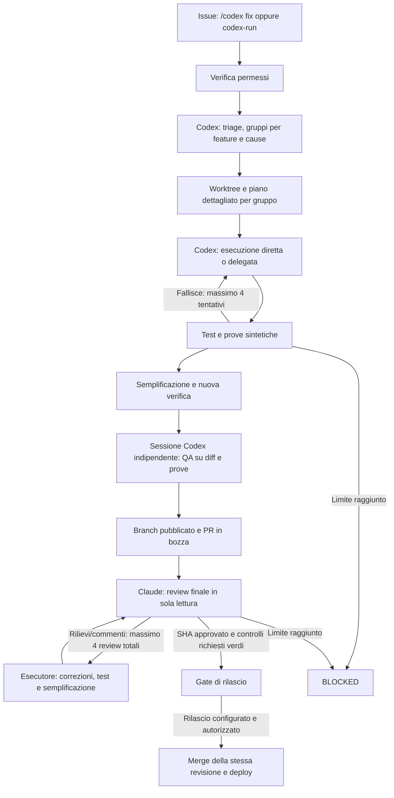

# Bug GitHub: Codex coordina e sceglie l'esecutore, Claude revisiona

## Comando e percorso

Apri una issue e scrivi **`/codex fix`**, oppure applica **`codex-run`**. Il comando deve provenire da un collaboratore con permesso write, maintain o admin. La form bug applica `bug` e `codex-triage`: queste due label da sole raccolgono segnalazioni e non autorizzano sessioni a pagamento. I workflow devono prima essere presenti nel branch predefinito e avere i prerequisiti sotto indicati.

GitHub Actions avvia il controller, serializzato per repository. Le sessioni e i terminali sono processi CLI nuovi nel runner, con risultati nei log Actions e nelle issue. Non dipendono da un terminale personale lasciato aperto. La riconciliazione periodica ogni 15 minuti recupera la coda e i commenti PR se un evento viene accorpato dalla concorrenza di Actions.



La PR richiede un branch remoto per ricevere la review. Per questo la pubblicazione del branch precede Claude; il merge in `main` e il deploy avvengono soltanto dopo i gate. Nessuna fase promette codice perfetto: un problema residuo lascia il gruppo bloccato.

## Ruoli e piano delegabile

La skill `.agents/skills/codex-bug-triage/SKILL.md` assegna a Codex l'analisi, il raggruppamento motivato, il worktree e il piano. Un gruppo contiene ogni issue selezionata una sola volta, criteri di accettazione distinti, file esatti da modificare, passi implementativi, test di regressione e prove browser. Le issue senza informazioni essenziali restano bloccate. I gruppi già presenti nel registro e le issue in lavorazione nel vecchio Agent Team vengono esclusi.

Il modello analista predefinito è **`gpt-6.1-sol`**; l'esecuzione predefinita è **`auto`**. Ogni piano valuta difficoltà, modalità diretta/delegata e motivazione. Codex può sviluppare tutto direttamente con 6.1-Sol: gruppi complessi, rischiosi o non sufficientemente delimitati restano al modello senior. Il lavoro circoscritto può essere delegato a un modello più piccolo; Luna è una delle opzioni.

Il router considera le sessioni effettivamente in corso nel controller e gli errori espliciti di capacità/rate limit. Se il delegato è occupato o temporaneamente indisponibile, sceglie il senior; un tentativo successivo al primo viene elevato al senior. Un errore non provoca retry nascosti: resta il budget esistente. Il carico globale del provider non viene stimato senza dati. La semplificazione mantiene l'esecutore scelto per il gruppo e `execution-history.json` registra le decisioni. I piani precedenti senza valutazione restano immutati e usano prudentemente il senior.

Per tenere **tutta l'implementazione in 6.1-Sol**, imposta `CODEX_EXECUTOR_MODEL=gpt-6.1-sol`; per la selezione automatica usa `auto`. `CODEX_SMALL_EXECUTOR_MODEL` sceglie il delegato opzionale (default `gpt-6-luna`). Gli ID predefiniti sono presenti nel [catalogo ufficiale Codex](https://github.com/openai/codex/blob/main/codex-rs/models-manager/models.json); l'account del runner deve poterli usare. Anche se sviluppo e QA usano 6.1-Sol, la verifica indipendente mantiene una sessione separata. Claude resta reviewer finale.

Il vecchio `agent-team:start` assegna lo sviluppo a Claude e rimane separato. Per questo flusso si usa `node agent-team/src/bug-pipeline/cli.mjs`.

## Verifica ed evidenze

Ogni gruppo usa `codex/bug-batch-N`, un worktree registrato sotto `agent-team/.worktrees/` e il pacchetto `artifacts/task-validation/bug-batch-N/`. Il contratto e il piano vengono congelati e verificati con hash. L'esecutore non gestisce commit, push, contatori o credenziali GitHub.

Il controller esegue i comandi del piano nel sandbox Codex, verifica gli exit code e richiede test di regressione e build frontend. Dopo la semplificazione ripete la verifica. Il piano deve includere l'avvio e l'arresto dei servizi locali necessari al test; il runner prepara dipendenze, Chromium, Python e PostgreSQL di test. Il database di sviluppo e la produzione non vengono usati. Le modifiche agli strumenti di controllo, ai workflow e alle credenziali richiedono un intervento separato e vengono rifiutate nei batch automatici.

Prima di ogni verifica le vecchie evidenze vengono rimosse: per ogni issue i test devono rigenerare PNG e trace Playwright, con video opzionale. I test browser devono asserire comportamento e valori attesi, controllare errori console/HTTP e verificare la persistenza dove necessaria, secondo la skill QA. Il controller controlla percorso, tipo, dimensione e digest dei file; questi controlli non sostituiscono le assertion del test. Le issue ricevono screenshot incorporati in Markdown e link immutabili a piano, risultati, trace e video associati allo SHA pubblicato. Solo dati sintetici: mai cartelle cliniche o credenziali nelle prove.

Prima della PR e dopo ogni correzione, una sessione Codex nuova e indipendente dall'esecutore applica la skill QA al diff, ai criteri e ai risultati generati dal controller. È in sola lettura e può bloccare il gruppo; il suo report viene conservato nel pacchetto. Un gate QA fallito rientra nel budget del tentativo corrente, senza aprire la PR o azzerare i contatori.

## Review e recupero

La skill `.claude/skills/bug-final-review/SKILL.md` mantiene Claude in sola lettura con Read/Glob/Grep, senza MCP. Il controller riutilizza `scripts/quality-gate/claude-bug-review.mjs`, il suo schema e il legame con lo SHA. La review viene pubblicata sulla PR; gli esecutori applicano le correzioni e ricreano tutte le prove. Anche commenti o review PR successivi all'approvazione invalidano la readiness e richiedono un altro giro disponibile. Thread irrisolti e review con richiesta di modifiche impediscono il rilascio; il bot non approva al posto di un reviewer umano.

I limiti sono separati: **4 tentativi di implementazione/verifica** e **4 review finali totali**, comprese quelle richieste da commenti successivi. I tentativi vengono prenotati prima della chiamata al modello e le chiamate fallite consumano il budget. Il preflight avviene prima di avviare il batch. Un'interruzione resta bloccata per recupero esplicito: niente quinto giro, cancellazione del registro o nuovo batch per aggirare il limite.

Il registro durevole è `.codex-bug-state.json` nel branch `codex/bug-control`, aggiornato tramite compare-and-swap. I report Claude e i digest rimangono nel registro e nei commenti PR per non cambiare lo SHA appena approvato. Worktree e file `.local` sono dati operativi; il registro GitHub non deve essere cancellato. Un errore CAS interrompe il controller. Il recupero richiede ispezionare stato, branch, HEAD, lock e tentativi prima di correggere la fase nello stesso registro; non è implementato un reset automatico.

## Configurazione GitHub Actions

In Settings → Secrets and variables → Actions:

| Nome                                 | Tipo               | Uso                                                                                                   |
| ------------------------------------ | ------------------ | ----------------------------------------------------------------------------------------------------- |
| `OPENAI_API_KEY`                     | Secret             | Sessioni Codex nel runner GitHub; il login ChatGPT della macchina cloud non si trasferisce ad Actions |
| `ANTHROPIC_API_KEY`                  | Secret             | Review finale Claude                                                                                  |
| `CODEX_PLANNER_MODEL`                | Variable opzionale | Default `gpt-6.1-sol`                                                                                 |
| `CODEX_EXECUTOR_MODEL`               | Variable opzionale | Default `auto`; `gpt-6.1-sol` forza tutta l'implementazione sul senior                                |
| `CODEX_SMALL_EXECUTOR_MODEL`         | Variable opzionale | Delegato opzionale, default `gpt-6-luna`                                                              |
| `CLINICOS_BOT_TOKEN`                 | Secret             | Token di bot/App con accesso al repository e PR; serve per avviare CI e deploy dai push del bot       |
| `BUG_PIPELINE_AUTO_RELEASE`          | Variable           | Abilita il workflow di rilascio automatico soltanto quando impostata a `true`                         |
| `VERCEL_TOKEN`                       | Secret             | Deploy frontend nel passo di rilascio, mai passato ai modelli                                         |
| `VERCEL_ORG_ID`, `VERCEL_PROJECT_ID` | Variables          | Identità del progetto Vercel, secondo il workflow di rilascio                                         |

Il token di fallback `github.token` permette la coda, i commenti e la PR, ma i suoi push non avviano automaticamente altri workflow. I controlli richiesti assenti o non completati bloccano la readiness: non vengono interpretati come successo. Configurare branch protection e i check richiesti su `main`. Il token di bot deve avere contents/issues/pull requests e i permessi strettamente necessari al monitoraggio CI; i secrets non entrano nell'ambiente delle shell dei modelli o dei test.

Il workflow `codex-bug-release.yml` fornisce il rilascio separato, con ambiente GitHub `production`. Il gate ricontrolla batch, SHA approvato, evidenze e PR prima del merge. I workflow esistenti Railway coprono backend e runtime AI dopo il push su `main`; il frontend usa il passo Vercel esplicito sul commit appena unito. Impostare le credenziali e le regole dell'ambiente `production` prima dell'attivazione. Nessun merge o deploy viene eseguito per installare questa automazione. Le issue restano aperte finché il risultato distribuito non è verificato; il successo del deploy non prova da solo la risoluzione clinica/funzionale.

## Ambiente cloud e diagnostica

CLI fissate: Codex 0.159.2, Claude Code 2.1.301. Installazione fuori dal checkout; autenticazione tramite binding supportati, mai copiata nel repository. Nell'ambiente Codex cloud si possono usare gli alias `CLINICOS_ANTHROPIC_API_KEY`, `CLINICOS_PLANNER_MODEL` e `CLINICOS_EXECUTOR_MODEL`. Il draft cloud e i secret di GitHub Actions sono configurazioni distinte.

```bash
node agent-team/src/bug-pipeline/cli.mjs --doctor
node --test agent-team/tests/bug-pipeline/*.test.mjs scripts/quality-gate/claude-bug-review.test.mjs
```

Il doctor verifica CLI, autenticazione, sandbox e presenza degli ID modello senza chiamate ai modelli. L'esecuzione locale richiede `--run` esplicito. Non dichiarare attivo il flusso solo perché i test con adapter simulati passano: servono workflow sul branch predefinito, credenziali utilizzabili e una prova reale autorizzata.
