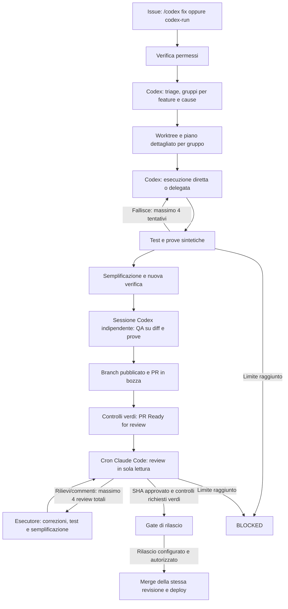

# Bug GitHub: Codex coordina e sceglie l'esecutore, Claude revisiona

## Comando e percorso

Apri una issue e scrivi **`/codex fix`**, oppure applica **`codex-run`**. Il comando deve provenire da un collaboratore con permesso write, maintain o admin. La form bug applica `bug` e `codex-triage`: queste due label da sole raccolgono segnalazioni e non autorizzano sessioni a pagamento. I workflow devono prima essere presenti nel branch predefinito e avere i prerequisiti sotto indicati.

GitHub Actions avvia il controller, serializzato per repository. Le sessioni e i terminali sono processi CLI nuovi nel runner, con risultati nei log Actions e nelle issue. Codex gira nel runner Actions; Claude usa il cron sul terminale personale già autenticato, come scelto dall’utente. La riconciliazione periodica ogni 15 minuti recupera la coda e i commenti PR se un evento viene accorpato dalla concorrenza di Actions.



La PR richiede un branch remoto per ricevere la review. Per questo la pubblicazione del branch precede Claude; il merge in `main` e il deploy avvengono soltanto dopo i gate. Nessuna fase promette codice perfetto: un problema residuo lascia il gruppo bloccato.

## Ruoli e piano delegabile

La skill `.agents/skills/codex-bug-triage/SKILL.md` assegna a Codex l'analisi, il raggruppamento motivato, il worktree e il piano. Un gruppo contiene ogni issue selezionata una sola volta, criteri di accettazione distinti, file esatti da modificare, passi implementativi, test di regressione e prove browser. Le issue senza informazioni essenziali restano bloccate. I gruppi già presenti nel registro e le issue in lavorazione nel vecchio Agent Team vengono esclusi.

Il modello analista predefinito è **`gpt-6.1-sol`**; l'esecuzione predefinita è **`auto`**. Ogni piano valuta difficoltà, modalità diretta/delegata e motivazione. Codex può sviluppare tutto direttamente con 6.1-Sol: gruppi complessi, rischiosi o non sufficientemente delimitati restano al modello senior. Il lavoro circoscritto può essere delegato a un modello più piccolo; Luna è una delle opzioni.

Il router considera le sessioni effettivamente in corso nel controller e gli errori espliciti di capacità/rate limit. Se il delegato è occupato o temporaneamente indisponibile, sceglie il senior; un tentativo successivo al primo viene elevato al senior. Un errore non provoca retry nascosti: resta il budget esistente. Il carico globale del provider non viene stimato senza dati. La semplificazione mantiene l'esecutore scelto per il gruppo e `execution-history.json` registra le decisioni. I piani precedenti senza valutazione restano immutati e usano prudentemente il senior.

Per tenere **tutta l'implementazione in 6.1-Sol**, imposta `CODEX_EXECUTOR_MODEL=gpt-6.1-sol`; per la selezione automatica usa `auto`. `CODEX_SMALL_EXECUTOR_MODEL` sceglie il delegato opzionale (default `gpt-6-luna`). Gli ID predefiniti sono presenti nel [catalogo ufficiale Codex](https://github.com/openai/codex/blob/main/codex-rs/models-manager/models.json); l'account del runner deve poterli usare. Anche se sviluppo e QA usano 6.1-Sol, la verifica indipendente mantiene una sessione separata. Claude resta reviewer finale.

Il vecchio `agent-team:start` assegna lo sviluppo a Claude e rimane separato. Per questo flusso si usa `node agent-team/src/bug-pipeline/cli.mjs`.

## Verifica ed evidenze

Ogni gruppo usa `codex/bug-batch-N`, un worktree registrato sotto `agent-team/.worktrees/` e il pacchetto `artifacts/task-validation/bug-batch-N/`. Il contratto e il piano vengono congelati e verificati con hash. L'esecutore non gestisce commit, push, contatori o credenziali GitHub.

Il controller esegue i comandi del piano nel sandbox Codex, verifica gli exit code e richiede test di regressione e build frontend. Dopo la semplificazione ripete la verifica. Ogni comando usa un profilo derivato da `:workspace`, con proxy gestito che nega tutti i domini esterni e consente solo i servizi locali. Il controller avvia PostgreSQL16 sintetico e applica le migrazioni dentro la stessa invocazione isolata, poi elimina il cluster. Il piano deve avviare e arrestare frontend/backend/runtime HTTP nello stesso script che esegue le assertion: i processi non si condividono tra comandi diversi. Il runner prepara dipendenze, Chromium, Python e binari PostgreSQL di test. Il check obbligatorio prova realmente HTTP, query SQL e migrazioni e richiede il rifiuto di TCP/UDP esterni, proxy HTTP/CONNECT e scritture fuori workspace. Il database di sviluppo e la produzione non vengono usati. Le modifiche agli strumenti di controllo, ai workflow e alle credenziali richiedono un intervento separato e vengono rifiutate nei batch automatici.

Prima di ogni verifica le vecchie evidenze vengono rimosse: per ogni issue i test devono rigenerare PNG e trace Playwright, con video opzionale. I test browser devono asserire comportamento e valori attesi, controllare errori console/HTTP e verificare la persistenza dove necessaria, secondo la skill QA. Il controller controlla percorso, tipo, dimensione e digest dei file; questi controlli non sostituiscono le assertion del test. Le issue ricevono screenshot incorporati in Markdown e link immutabili a piano, risultati, trace e video associati allo SHA pubblicato. Solo dati sintetici: mai cartelle cliniche o credenziali nelle prove.

Prima della PR e dopo ogni correzione, una sessione Codex nuova e indipendente dall'esecutore applica la skill QA al diff, ai criteri e ai risultati generati dal controller. È in sola lettura e può bloccare il gruppo; il suo report viene conservato nel pacchetto. Un gate QA fallito rientra nel budget del tentativo corrente, senza aprire la PR o azzerare i contatori.

## Review e recupero

### Stati issue e dashboard operativa

La prenotazione durevole precede la presa in carico: tutte le issue del gruppo ricevono la label **In progress** prima del triage. Test, semplificazione, pubblicazione PR, review e attesa dei check hanno fasi distinte nel registro. Un errore o un budget esaurito imposta **Bloccato** e mantiene aperta la issue. Una review approvata o il solo merge non significano risoluzione.

Dopo la conferma del rilascio della revisione verificata, il controller pubblica il riepilogo e i collegamenti alle prove, applica **Risolto** e chiude la issue con motivo `completed`. Le label estranee vengono conservate. Alla successiva esecuzione, eventuali aggiornamenti GitHub falliti vengono ripetuti dallo stato durevole senza rilanciare modelli o azzerare contatori.

La dashboard operativa si avvia con `node agent-team/src/bug-pipeline/dashboard-server.mjs` e ascolta solo su `http://127.0.0.1:4317`. Mostra coda autorizzata, issue gestite da altri flussi, fase registrata, gruppi, PR e tentativi utilizzati. Legge GitHub ogni 15 secondi tramite autenticazione del server; non trasferisce token, corpi issue o report dei modelli al browser. Errori e dati non aggiornati restano visibili. È una superficie locale di monitoraggio, separata dall'app clinica pubblica; l'apertura nel pannello Codex richiede la disponibilità del collegamento alla macchina cloud.

La skill `.claude/skills/bug-final-review/SKILL.md` mantiene Claude in sola lettura con Read/Glob/Grep, senza MCP. Il controller riutilizza `scripts/quality-gate/claude-bug-review.mjs`, il suo schema e il legame con lo SHA. La review viene pubblicata sulla PR; gli esecutori applicano le correzioni e ricreano tutte le prove. Anche commenti o review PR successivi all'approvazione invalidano la readiness e richiedono un altro giro disponibile. Thread irrisolti e review con richiesta di modifiche impediscono il rilascio; il bot non approva al posto di un reviewer umano.

I limiti sono separati: **4 tentativi di implementazione/verifica** e **4 review finali totali**, comprese quelle richieste da commenti successivi. I tentativi vengono prenotati prima della chiamata al modello e le chiamate fallite consumano il budget. Il preflight avviene prima di avviare il batch. Un'interruzione resta bloccata per recupero esplicito: niente quinto giro, cancellazione del registro o nuovo batch per aggirare il limite.

Il registro durevole è `.codex-bug-state.json` nel branch `codex/bug-control`, aggiornato tramite compare-and-swap. I report Claude e i digest rimangono nel registro e nei commenti PR per non cambiare lo SHA appena approvato. Worktree e file `.local` sono dati operativi; il registro GitHub non deve essere cancellato. Un errore CAS interrompe il controller. Il recupero richiede ispezionare stato, branch, HEAD, lock e tentativi prima di correggere la fase nello stesso registro; non è implementato un reset automatico.

## Configurazione GitHub Actions

In Settings → Secrets and variables → Actions:

| Nome                                 | Tipo               | Uso                                                                                                   |
| ------------------------------------ | ------------------ | ----------------------------------------------------------------------------------------------------- |
| `OPENAI_API_KEY`                     | Secret             | Sessioni Codex nel runner GitHub; il login ChatGPT della macchina cloud non si trasferisce ad Actions |
| `CODEX_PLANNER_MODEL`                | Variable opzionale | Default `gpt-6.1-sol`                                                                                 |
| `CODEX_EXECUTOR_MODEL`               | Variable opzionale | Default `auto`; `gpt-6.1-sol` forza tutta l'implementazione sul senior                                |
| `CODEX_SMALL_EXECUTOR_MODEL`         | Variable opzionale | Delegato opzionale, default `gpt-6-luna`                                                              |
| `CLINICOS_BOT_TOKEN`                 | Secret             | Token di bot/App con accesso al repository e PR; serve per avviare CI e deploy dai push del bot       |
| `BUG_PIPELINE_AUTO_RELEASE`          | Variable           | Abilita il workflow di rilascio automatico soltanto quando impostata a `true`                         |
| `VERCEL_TOKEN`                       | Secret             | Deploy frontend nel passo di rilascio, mai passato ai modelli                                         |
| `VERCEL_ORG_ID`, `VERCEL_PROJECT_ID` | Variables          | Identità del progetto Vercel, secondo il workflow di rilascio                                         |

### Harness Claude Code esterno

Il controller Actions usa `BUG_PIPELINE_REVIEW_MODE=external`: non installa Claude e non legge token Max o API Anthropic. Dopo test e check obbligatori rende la PR **Ready for review**, salva una richiesta legata allo SHA e attende. Il cron dell’utente esegue dal checkout fidato:

```bash
node agent-team/src/bug-pipeline/claude-review-cron.mjs
```

Su **Windows** si usa l'Utilità di pianificazione, non `crontab`. Dal checkout dedicato della PR:

```powershell
node scripts/automation/install-claude-review-windows.mjs
node scripts/automation/install-claude-review-windows.mjs --check
```

`setup-claude-review-windows.ps1` prepara automaticamente un checkout separato sotto `%LOCALAPPDATA%\ClinicOS\review-checkout` e avvia l'installer. Non cambiare branch nella cartella di lavoro se Git segnala file locali: non serve stash/reset/clean. Il bootstrap conserva checkout sporchi, origini diverse, altre branch e commit locali; aggiorna soltanto tramite fast-forward il checkout dedicato. I file di questo script devono essere disponibili dalla PR: un checkout fallito lascia assente l'installer e causa `MODULE_NOT_FOUND`.

Il task Windows è per l'utente corrente, con login interattivo, privilegi normali e nessuna password aggiuntiva. Ogni cinque minuti richiama Node con percorsi assoluti, file di stato sotto `%LOCALAPPDATA%\ClinicOS\claude-review`, ACL del solo utente e blocco delle sovrapposizioni. Richiede computer acceso, connesso e utente collegato; non è un servizio cloud. `--check` e `--remove` verificano identità, azione e impostazioni prima di dichiarare installato o rimuovere il task. Native CLI e installazione npm di Claude sono supportate senza eseguire shim `.cmd` tramite shell. Restano necessari login Pro/Max locale e `gh` con permessi sul repository.

Nota Windows Store/MSIX: un alias sotto AppData può essere visto da Git come un percorso fisico diverso. Il bootstrap conserva il rifiuto di percorsi non coincidenti: non rimuovere i controlli di redirezione. In questo caso usare il percorso fisico verificato da `git -C <checkout> rev-parse --show-toplevel` come `-Destination` e la corrispondente radice fisica per `LOCALAPPDATA` **solo nel processo di installazione/check**, ripristinando poi il valore. Non modificare l'ambiente globale né ricopiare credenziali. L'attività registra percorsi assoluti utilizzabili anche fuori da Codex; se risiedono nei dati dell'app MSIX, reinstallare il setup prima di disinstallare Codex.

I test Windows usano repository e file sintetici: la mutazione ACL negativa modifica solo la DACL, non richiede privilegi SACL e verifica che proprietario/protezione restino invariati. Il solo processo PowerShell della fixture bootstrap usa `RemoteSigned` per i file locali appena creati; le policy MachinePolicy/UserPolicy/LocalMachine/CurrentUser vengono confrontate prima/dopo. Non si usa `Bypass`, non si modifica la policy globale e le GPO imposte restano applicabili. Tutte le assertion di preservazione restano necessarie.

Il cron è versionato in `scripts/automation/claude-review.crontab`. Per installarlo su **Mac/Linux**, dal checkout di questa PR sul computer persistente dove Claude Code è già collegato a Max e `gh` è autenticato, basta:

```bash
node scripts/automation/install-claude-review-cron.mjs
```

L'installer controlla Node, Git, `gh`, `crontab`, permessi GitHub e login Pro/Max, senza chiamare un modello. Installa nel crontab dell'utente una sola voce ogni cinque minuti, preserva gli altri job e rilegge il risultato per verificarlo. Launcher e log privati restano fuori dal repository, sotto `~/.local/state/clinicos-claude-review/`. Usa percorsi assoluti e un lock locale; un lock lasciato da un'interruzione richiede ispezione, non viene cancellato automaticamente. Il computer deve restare acceso e connesso: il cron personale non gira quando è spento o in sospensione.

```bash
node scripts/automation/install-claude-review-cron.mjs --check
node scripts/automation/install-claude-review-cron.mjs --remove
```

`--check` è di sola lettura: `installed=true` richiede voce esatta, delimitatori completi e launcher/log privati e validi. Prerequisiti disponibili senza voce installata non significano cron attivo. `--remove` elimina soltanto la voce di questo checkout e conserva file/log. Non viene installato un daemon permanente nel cloud temporaneo: qui mancano `crontab` e il login personale Max. La pianificazione GitHub ogni quindici minuti diventa attiva quando i workflow arrivano su `main`; quella personale ogni cinque minuti esegue Claude. Nessuna delle due prove sostituisce una review reale autenticata.

Le issue aperte non entrano tutte automaticamente nella coda. Dopo l'attivazione su `main`, aggiungere `codex-run` oppure commentare `/codex fix` sulle issue scelte; il controller le classifica e può accorpare quelle simili. Le issue già `ready-for-qa` continuano il loro flusso e non vanno riavviate come nuove implementazioni. Per verificare la situazione corrente usare la dashboard e il registro, non il solo numero di issue aperte.

Il comando processa al massimo una richiesta per esecuzione. Usa `gh` già autenticato con accesso write al repository e Claude Code già collegato a Pro/Max: il controllo `auth status` richiede `authMethod=claude.ai` e abbonamento `pro`/`max`. La configurazione è quella personale `.claude`, oppure il percorso assoluto `CLINICOS_CLAUDE_CONFIG_DIR`. Non genera, copia o richiede token; rimuove le chiavi API e i token OAuth dall’ambiente del modello. Un login diverso blocca la review senza ripiego API. Il task può essere richiamato ogni cinque minuti dal cron personale; il registro CAS impedisce due inferenze per lo stesso tentativo, anche fra cron sovrapposti.

Il reviewer prepara un worktree temporaneo sul commit esatto, applica la skill di sola lettura e prenota il tentativo remoto **prima** della chiamata. Salva report e digest nel registro esistente e pubblica una review GitHub `COMMENT` legata al commit: non impersona approvazioni umane. Un POST fallito viene ripetuto senza una nuova inferenza. Per la PR di installazione471 riutilizza il registro `setupReview471`, incluso il primo tentativo fallito; non riparte da zero.

Gli eventi review/commento e la riconciliazione ogni15minuti riportano il controllo a Codex. Codex accetta soltanto un report strutturato verificato nel registro, mai la parola “approved” in un commento. Rilievi o commenti nuovi avviano correzione, test, semplificazione, QA, nuove prove e un nuovo SHA, quindi un’altra richiesta al cron. Una review pulita consente il gate di rilascio solo se coincidono SHA, commenti, check e protezioni. Le issue ricevono il riepilogo dell’esito; la dashboard mostra attesa cron e review in corso. Il limite resta quattro, senza retry di modelli nascosti.

Il token di fallback `github.token` permette la coda, i commenti e la PR, ma i suoi push non avviano automaticamente altri workflow. I controlli richiesti assenti o non completati bloccano la readiness: non vengono interpretati come successo. Configurare branch protection e i check richiesti su `main`. Il token di bot deve avere contents/issues/pull requests e i permessi strettamente necessari al monitoraggio CI; i secrets non entrano nell'ambiente delle shell dei modelli o dei test.

Il workflow `codex-bug-release.yml` fornisce il rilascio separato, con ambiente GitHub `production`. Il gate ricontrolla batch, SHA approvato, evidenze e PR prima del merge. I workflow esistenti Railway coprono backend e runtime AI dopo il push su `main`; il frontend usa il passo Vercel esplicito sul commit appena unito. Impostare le credenziali e le regole dell'ambiente `production` prima dell'attivazione. Nessun merge o deploy viene eseguito per installare questa automazione. Le issue restano aperte finché il risultato distribuito non è verificato; il successo del deploy non prova da solo la risoluzione clinica/funzionale.

## Ambiente cloud e diagnostica

CLI fissate: Codex 0.159.2, Claude Code 2.1.301. Installazione fuori dal checkout; autenticazione tramite binding supportati, mai copiata nel repository. Il controller cloud usa gli alias `CLINICOS_PLANNER_MODEL` e `CLINICOS_EXECUTOR_MODEL`; il reviewer esterno usa la sessione personale Claude Code. Il draft cloud e i secret di GitHub Actions sono configurazioni distinte.

```bash
node agent-team/src/bug-pipeline/cli.mjs --doctor
node --test agent-team/tests/bug-pipeline/*.test.mjs scripts/quality-gate/claude-bug-review.test.mjs
```

Il doctor verifica CLI, autenticazione, sandbox e presenza degli ID modello senza chiamate ai modelli. L'esecuzione locale richiede `--run` esplicito. Non dichiarare attivo il flusso solo perché i test con adapter simulati passano: servono workflow sul branch predefinito, credenziali utilizzabili e una prova reale autorizzata.
