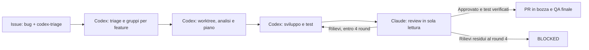

# Bug GitHub: Codex sviluppa, Claude revisiona

## Uso

1. Apri un bug con il modulo **Bug da analizzare con Codex** oppure applica `bug` e
   `codex-triage` a una issue esistente.
2. In Codex richiama la skill: `$codex-bug-triage processa la coda bug di l2v-hub/ClinicOS`.
3. Codex legge le issue, aggrega duplicati e problemi vicini nella stessa feature,
   analizza cause e dipendenze e prepara un worktree e un piano per ogni gruppo.
4. Codex implementa il piano, esegue i test e prepara il codice per la review.
5. Claude revisiona; Codex applica le correzioni e ripete i controlli. Massimo **4 round**.



Codex resta il responsabile dello sviluppo. Il vecchio `agent-team:start`, che assegna
lo sviluppo a Claude, appartiene a un flusso diverso e non va avviato per questa coda.

## Materiale per ogni gruppo

La skill prepara un indice delle issue e, nel worktree del gruppo, una cartella
`artifacts/task-validation/bug-batch-<issue-guida>/` con contratto, analisi, piano,
criteri di accettazione per ogni issue, test ed evidenze. Le issue soltanto simili
forniscono contesto; non entrano automaticamente nell'ambito della correzione.

Il piano precede le modifiche. I duplicati vengono segnalati con una motivazione;
le issue non vengono chiuse automaticamente. Branch e worktree distinti mantengono
isolati i gruppi, con dipendenze esplicite quando condividono codice.

## Review Claude

Serve una CLI Claude Code che supporti `--restricted`, `--json-schema` e gli altri
flag verificati dal runner. La CLI deve essere autenticata tramite il normale
`claude auth login` o un binding supportato; mai inserire credenziali nei file.

Dal worktree del gruppo, dopo aver committato codice, piano ed evidenze:

```bash
node scripts/quality-gate/claude-bug-review.mjs \
  artifacts/task-validation/bug-batch-<issue-guida>
```

Claude usa la skill `.claude/skills/bug-final-review/SKILL.md`, con soli strumenti
Read/Glob/Grep e senza server MCP aggiuntivi. Restituisce un risultato strutturato
associato al commit analizzato. Codex, non Claude, applica le modifiche e lancia i test.

Il runner conserva il numero dei tentativi in `claude-review-state.local`, con un
lock per chiamate concorrenti. Conservare questo file attraverso tutti i round
dello stesso gruppo; non cancellarlo per ricominciare il conteggio. Una revisione
rifiutata richiede un nuovo commit prima del round successivo. Codice modificato
dopo l'approvazione richiede un'altra review disponibile. L'autenticazione mancante
prima della chiamata non consuma round; una chiamata avviata e fallita lo consuma.

Il quinto round è bloccato. Dopo quattro round, rilievi o verifiche fallite restano
`BLOCKED` / `FAILED VALIDATION`, senza dichiarazioni di codice “perfetto”.

## Attivazione e limiti verificabili

La label mette il bug in coda e il modulo GitHub la applica automaticamente. Una
skill viene eseguita dentro una sessione Codex: il solo inserimento della label
non crea un nuovo task cloud. Un avvio automatico richiede un trigger effettivamente
configurato e verificato; questa modifica non ne simula l'esistenza.

La pipeline non usa il token Railway, dati di produzione, deploy o merge. Le
credenziali GitHub/Codex sono quelle della sessione. Il pacchetto finale riporta
issue sorgenti, ramo/worktree, SHA revisionato, test eseguiti, round Claude e rischi
residui; la PR resta in bozza fino alla decisione QA.

La suite del runner si esegue con:

```bash
node --test scripts/quality-gate/claude-bug-review.test.mjs
```
